# Awesome Computer Vision Image Classification 👁️⚡

  

  
  
  
  
  
  
  

---

## 📖 Overview & SEO Summary

A curated, comprehensive directory of state-of-the-art **Computer Vision (CV)** and **Image Classification** tools, frameworks, and hosted platforms. Whether you are building real-time visual recognition pipelines, fine-tuning Vision Transformers (ViT), implementing convolutional neural networks (CNNs), or deploying production-grade cloud visual inference APIs, this resource compiles the category leaders across the global AI ecosystem.

* **Key Focus Areas:** Image Classification, Object Recognition, Vision Transformers (ViT), Convolutional Networks (ResNet, ConvNeXt, EfficientNet), Zero-Shot Visual Classification (CLIP), Self-Supervised Vision (DINOv2), Data-Centric AI, and Production Edge Inference.
* **Target Audience:** Machine Learning Engineers, Data Scientists, Computer Vision Researchers, and Autonomous Systems Developers.
* **Updated:** October 2026

---

## 📑 Table of Contents

- [📊 Sector Overview & Market Dynamics](#-sector-overview--market-dynamics)
- [☁️ SaaS/Hosted Platforms](#️-saashosted-platforms)
- [📦 Open-Source GitHub Projects](#-open-source-github-projects)
- [🛠️ Production Architecture Recommendations](#️-production-architecture-recommendations)
- [🤝 How to Contribute](#-how-to-contribute)
- [💖 Support](#-support)
- [⭐ Star History](#-star-history)
- [⚖️ Disclaimer](#️-disclaimer)

---

## 📊 Sector Overview & Market Dynamics

The global computer vision market is estimated at approximately **$23B to $33B in 2025–2026**, projected to surpass **$80B to $100B+** into the mid-2030s at an accelerated Compound Annual Growth Rate (CAGR) of **~15%–19%**.

The sector exhibits **moderate concentration / fragmentation**:
* **Infrastructure & Foundational Cloud APIs:** Highly concentrated among hyperscale cloud providers (**Microsoft Azure**, **Google Cloud**, **Amazon Web Services**) offering high-throughput, managed multi-tenant visual recognition APIs and foundation model inference.
* **Vertical Solutions & Edge AI:** Moderately to highly fragmented across specialized computer vision software vendors catering to industrial quality inspection, manufacturing defect detection, medical diagnostic imaging, autonomous navigation, and dataset curation.

---

## ☁️ SaaS/Hosted Platforms

The following SaaS platforms provide hosted computer vision APIs, automated transfer learning pipelines, and managed visual data infrastructure. The table is ranked in descending order by parent company scale (Market Capitalization / Valuation / Revenue).

| 🏢 Platform | 🏛️ Parent Company | 📈 Company Scale (Market Cap / Valuation / Revenue) | 📝 Description | 💳 Pricing (Starting Paid Tier) | 🎁 Free Tier Limits |
| :--- | :--- | :--- | :--- | :--- | :--- |
| **[Google Cloud Vision](https://cloud.google.com/vision)** | Alphabet / Google | ~$4.2T Market Cap (~$403B+ Rev) | Pre-trained and AutoML vision models for label detection, classification, OCR, and moderation. | $1.50 per 1,000 units (1,001–5,000,000 units/mo) | 1,000 units per month free forever (plus $300 new customer credit) |
| **[Azure Computer Vision](https://azure.microsoft.com/en-us/products/ai-services/ai-vision)** | Microsoft | ~$3.9T Market Cap (~$331.8B Rev) | Prebuilt and customizable models for image tagging, classification, caption generation, and domain detection. | $1.00 per 1,000 transactions (Standard S1 tier) | 5,000 transactions per month (F0 Free Tier, max 20 calls/min) |
| **[AWS Rekognition](https://aws.amazon.com/rekognition/)** | Amazon | ~$2.7T Market Cap (~$600B+ Rev) | Deep learning image & video analysis for object/scene classification, moderation, and Custom Labels. | $1.00 per 1,000 images analyzed (Tier 1: first 1M images/mo) | 5,000 images analyzed per month during the 12-month AWS Free Tier |
| **[Salesforce Einstein Image Classification](https://www.salesforce.com/)** | Salesforce | ~$187B Market Cap (~$41.5B Rev) | Deep learning image classification and object detection service integrated with Salesforce CRM workflows. | $25/user/month (Starter Suite) to $500+/mo via Einstein add-on credits / Agentforce usage packs | 2,000 free prediction calls/month (developer tier historically) or 30-day trial |
| **[Scale AI](https://scale.com/)** | Scale AI | ~$29B Valuation (~$1B Rev) | Data curation, automated labeling, and model evaluation platform for production classification pipelines. | $0.05 per labeling unit (Self-Serve pay-as-you-go above allowance) | 1,000 labeling units & 10,000 images in free self-serve tier |
| **[Clarifai](https://www.clarifai.com/)** | Clarifai (Nebius) | ~$100M+ Raised / Acquired | Visual AI tagging and classification platform supporting custom model training and evaluation. | $30/month (Essential plan) | 1,000 operations (API calls) per month free forever (Community plan) |
| **[Roboflow](https://roboflow.com/)** | Roboflow | ~$60M+ Raised | End-to-end computer vision platform with dataset versioning, auto-labeling, and model deployment. | $39/month billed annually ($99/month billed monthly, Core plan) | $60/month recurring credits (up to 10 projects, 250k public images) |
| **[Landing AI](https://landing.ai/)** | Landing AI | ~$57M Raised (~$34.2M Rev) | Data-centric computer vision platform specialized in visual inspection, defect detection, and document extraction. | $250/month (Team plan) or $0.01 per extraction credit pay-as-you-go | 14-day free trial with 1,000 free credits |
| **[V7 Go](https://www.v7labs.com/)** | V7 Labs | ~$33M–$36M Raised/Valuation | Multimodal AI platform combining computer vision with document understanding and classification workflows. | $5,400/year (Darwin Team) / custom annual contracts for V7 Go | Free forever plan with baseline Go Tokens allocation for workflows |
| **[Nyckel](https://www.nyckel.com/)** | Nyckel | ~$3M Estimated Annual Rev | Quick-deploy API and no-code platform for custom image and text classification. | $149/month (Standard tier) | 1,000 classifications per month free forever |

---

## 📦 Open-Source GitHub Projects

Open-source libraries, pretrained backbones, benchmarks, and production inference engines for visual classification. Repositories are ranked in **descending order by GitHub star count**. Each badge links directly to the repository's stargazers page.

1. **[TensorFlow](https://github.com/tensorflow/tensorflow)**   
   End-to-end open-source machine learning platform (Apache-2.0). Provides Keras high-level APIs for convolutional neural networks, transfer learning modules, and TensorFlow Lite / TF Serving for edge and server deployment.

2. **[Hugging Face Transformers](https://github.com/huggingface/transformers)**   
   State-of-the-art Machine Learning for Pytorch, TensorFlow, and JAX (Apache-2.0). Contains thousands of pretrained vision transformers including ViT, Swin, BEiT, ConvNeXt, and multimodal image-text models with seamless fine-tuning APIs.

3. **[PyTorch](https://github.com/pytorch/pytorch)**   
   Leading open-source deep learning framework (BSD-3-Clause). Foundation for modern CV research and production systems, with native dynamic computation graphs, TorchScript JIT compiler, and distributed GPU acceleration.

4. **[OpenCV](https://github.com/opencv/opencv)**   
   Open Source Computer Vision Library (Apache-2.0). The industry standard for classical image processing, filtering, matrix operations, and a fast Deep Neural Network (DNN) inference engine supporting ONNX and Caffe models.

5. **[scikit-learn](https://github.com/scikit-learn/scikit-learn)**   
   Machine learning in Python (BSD-3-Clause). Standard toolkit for feature-based image classification pipelines utilizing HOG/SIFT feature extractors with Support Vector Machines (SVM), Random Forests, and Gradient Boosting.

6. **[Ultralytics (YOLO)](https://github.com/ultralytics/ultralytics)**   
   Industry-standard computer vision architecture (AGPL-3.0 / Enterprise). Features dedicated ultra-fast image classification heads (`yolo classify train`) alongside detection, segmentation, and pose estimation.

7. **[Gradio](https://github.com/gradio-app/gradio)**   
   Rapid UI development framework for ML demos (Apache-2.0). Create interactive browser-based classification interfaces with drag-and-drop image upload, webcam capture, and confidence bar charts in Python.

8. **[Timm (PyTorch Image Models)](https://github.com/huggingface/pytorch-image-models)**   
   The definitive collection of pretrained image models, weights, layers, and optimizers (Apache-2.0). Includes hundreds of backbones ranging from MobileNet to ViT, Swin, EVA, and ConvNeXt with ImageNet-1k/22k checkpoints.

9. **[Detectron2](https://github.com/facebookresearch/detectron2)**   
   FAIR's next-generation platform for visual object recognition and classification (Apache-2.0). Provides modular backbones, feature pyramid networks (FPN), and export utilities for high-throughput deployment.

10. **[OpenAI CLIP](https://github.com/openai/CLIP)**   
    Contrastive Language-Image Pre-Training (MIT). Groundbreaking multimodal foundation model enabling zero-shot image classification across unseen label spaces using natural language prompt embeddings.

11. **[MMDetection](https://github.com/open-mmlab/mmdetection)**   
    OpenMMLab visual detection and recognition toolbox (Apache-2.0). Features benchmarked visual feature extractors, classification heads, and GPU inference engines.

12. **[Label Studio](https://github.com/HumanSignal/label-studio)**   
    Multi-type data labeling and annotation platform (Apache-2.0). Essential for creating single-label and multi-label image classification training sets with active learning hooks.

13. **[FastAI](https://github.com/fastai/fastai)**   
    High-level deep learning library (Apache-2.0) built on top of PyTorch. Streamlines image classification training with one-cycle learning rate scheduling, mixed-precision training, and model interpretation tools.

14. **[LabelImg](https://github.com/HumanSignal/labelImg)**   
    Lightweight graphical image annotation tool (MIT). Classic desktop utility for rapidly creating annotated image datasets.

15. **[ONNX Runtime](https://github.com/microsoft/onnxruntime)**   
    Cross-platform high-performance ML scoring engine (MIT). Optimized execution engine for running exported image classification ONNX graphs across CPUs, GPUs, and NPUs with TensorRT and DirectML acceleration.

16. **[ONNX](https://github.com/onnx/onnx)**   
    Open standard format for representing machine learning models (Apache-2.0). Enables interoperability between PyTorch, TensorFlow, and edge deployment runtimes.

17. **[TorchVision](https://github.com/pytorch/vision)**   
    Official PyTorch domain library for computer vision (BSD-3-Clause). Ships reference implementations of ResNet, EfficientNet, VGG, MobileNet, and Vision Transformers, accompanied by torchvision transforms v2.

18. **[CVAT (Computer Vision Annotation Tool)](https://github.com/cvat-ai/cvat)**   
    Interactive video and image annotation tool for computer vision (MIT). Supports collaborative team workflows for labeling classification tags, polygons, and bounding boxes.

19. **[Albumentations](https://github.com/albumentations-team/albumentations)**   
    Fast and flexible image augmentation library (MIT). Widely adopted across competitive Kaggle ML and production classification pipelines for photometric and spatial image transforms.

20. **[Meta DINOv2](https://github.com/facebookresearch/dinov2)**   
    State-of-the-art self-supervised vision transformer foundation models by Meta (Apache-2.0). Produces universal image representations that yield exceptional k-NN and linear probe classification accuracy without fine-tuning.

21. **[Vision Transformer (ViT)](https://github.com/google-research/vision_transformer)**   
    Official Google Research codebase for the seminal "An Image is Worth 16x16 Words: Transformers for Image Recognition at Scale" paper (Apache-2.0) in JAX/Flax and PyTorch.

22. **[Cleanlab](https://github.com/cleanlab/cleanlab)**   
    Data-centric AI package (AGPL-3.0). Automatically detects mislabeled images, out-of-distribution samples, and label ambiguity in classification datasets to boost real-world test accuracy.

23. **[FiftyOne](https://github.com/voxel51/fiftyone)**   
    Open-source tool for dataset visualization and model analysis (Apache-2.0). Interactively visualize image embeddings (UMAP/t-SNE), detect model failure modes, and evaluate classification confusion matrices.

24. **[PaddleClas](https://github.com/PaddlePaddle/PaddleClas)** [?style=social&color=white](https://github.com/PaddlePaddle/PaddleClas/stargazers)  
    Industrial image classification and recognition toolkit based on PaddlePaddle (Apache-2.0). Offers 200+ lightweight models, knowledge distillation, metric learning, and automated quant-aware deployment.

25. **[SuperGradients](https://github.com/Deci-AI/super-gradients)**   
    PyTorch-based computer vision training library (Apache-2.0). Delivers pre-configured training recipes, hardware-aware neural architecture search backbones, and quantization routines.

26. **[OpenMMLab MMPreTrain](https://github.com/open-mmlab/mmpretrain)**   
    Unified visual pre-training and classification framework (Apache-2.0). Successor to MMClassification, standardizing hundreds of backbones, self-supervised learning algorithms, and multi-task heads.

27. **[FujiCV](https://github.com/dsabarinathan/fujicv)**   
    Lightweight PyTorch library for image classification, regression, and multi-label learning with built-in Grad-CAM explainability, ONNX export, and Optuna hyperparameter optimization.

---

## 🛠️ Production Architecture Recommendations

To build an end-to-end, high-performance self-hosted image classification system:
* 🧩 **Model Backbones:** Pair **PyTorch** with **Timm** or **Hugging Face Transformers** for access to pretrained ViT, Swin, ConvNeXt, or self-supervised **DINOv2** representations.
* 🧹 **Data Quality & Augmentation:** Utilize **Albumentations** for robust training-time augmentation and **Cleanlab** to filter out noisy label noise.
* 🔍 **Evaluation & Curation:** Inspect class distributions and edge cases interactively using **FiftyOne**.
* ⚡ **High-Throughput Inference:** Export trained checkpoints to **ONNX** and serve via **ONNX Runtime**, **TensorRT**, or **Triton Inference Server**.

---

## 🤝 How to Contribute

Contributions are welcome! Please follow these steps:
1. 🍴 Fork the repository.
2. 🌿 Create a new feature branch (`git checkout -b feature/new-cv-entry`).
3. ✏️ Add or update entries in `README.md` following the established format and star-sorted order.
4. 🚀 Submit a Pull Request with a clear description of your additions.

---

## 💖 Support

If you find this curated computer vision guide useful, please consider:
* ⭐ **Starring** the repository on GitHub to help others discover it.
* 🍴 **Forking** and contributing new models or production benchmarks.
* 📢 **Sharing** with your colleagues, research groups, and ML communities.
* ☕ **Buying a Coffee / Sponsoring** the maintainer via the [GitHub Sponsor Dashboard](https://github.com/sponsors/ishandutta2007). Thank you for your support!

---

## ⭐ Star History

---

## ⚖️ Disclaimer

- This repository is a **community-curated** resource and does not constitute an explicit commercial endorsement.
- All trademarks and product names belong to their respective corporate owners.
- Image classification workflows must comply with applicable privacy, consumer protection, and biometric laws (e.g., GDPR, CCPA, BIPA).

---

  Built with ❤️ for ML engineers, computer vision practitioners, and data scientists worldwide.

